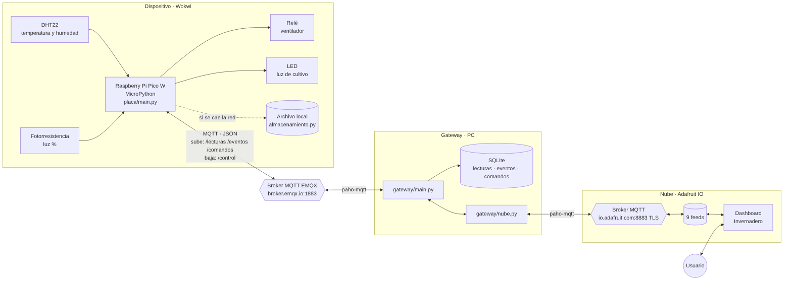

# Invernadero IoT

Sistema IoT que monitorea y controla las condiciones de cultivo de un invernadero simulado en Wokwi. Parcial 2 de Desarrollo de Software VIII, Universidad Tecnológica de Panamá.

La Pico W lee la temperatura, la humedad y la luz, y enciende el ventilador o la luz de cultivo según umbrales. Envía todo por MQTT a un gateway en Python, que lo guarda en SQLite y lo muestra en un dashboard de Adafruit IO. Desde el dashboard se pueden encender y apagar los actuadores y cambiar entre modo automático y manual.



## Integrantes y aportes

| Integrante | Usuario GitHub | Aporte |
|---|---|---|
| Francisco Lata | fran0699 | Placa: sensores, actuadores y circuito. Circuito en Wokwi, lectura de sensores, control de actuadores, reglas automáticas, capturas y zip de Wokwi |
| José Luna | Josamatsu19 | Placa: conexión y eventos. Wi-Fi, hora NTP, cliente MQTT, muestreo con `Timer`, guardado local si se cae la conexión y `main.py` |
| Juan Vasquez | java0594 | Gateway y base de datos. Gateway en Python, SQLite, scripts SQL, consultas de históricos y `requirements.txt` |
| Luis Barnett | Iambarnett | Nube y documentación. Adafruit IO (dashboard y botones), conexión del gateway con la nube, diagramas de arquitectura y flujo de datos, configuración de la nube y README |

## Cómo cumple los requisitos del parcial

| Requisito | Cómo se cumple | Dónde |
|---|---|---|
| Mínimo 2 sensores | DHT22 (temperatura y humedad) y fotorresistencia (luz) | `placa/sensores.py` |
| Mínimo 2 actuadores | Relé del ventilador y LED de la luz de cultivo | `placa/actuadores.py` |
| GPIO con librerías apropiadas | `machine.Pin`, `machine.ADC` y `dht` de MicroPython | `placa/` |
| Lectura en tiempo real | `Timer` cada 5 s | `placa/main.py` |
| Control de actuadores | Reglas automáticas por umbral y órdenes desde el dashboard | `placa/reglas.py`, `placa/conexion_mqtt.py` |
| Cliente MQTT en el dispositivo | Broker público EMQX | `placa/conexion_mqtt.py` |
| Base de datos con timestamp, eventos y comandos | SQLite con tablas `lecturas`, `eventos` y `comandos` | `gateway/base_datos.py`, `sql/` |
| Consultas de históricos | Últimos registros de cada tabla desde la terminal | `gateway/consultas.py` |
| Plataforma en la nube con dashboard en tiempo real | Adafruit IO: medidores, gráfica e indicadores | `gateway/nube.py`, [configuración](docs/configuracion_nube.md) |
| Comandos desde la nube hacia el dispositivo | Botones del dashboard → gateway → `/control` → placa | `gateway/nube.py`, `gateway/main.py` |
| Programación modular y orientada a eventos | Un módulo por responsabilidad; callbacks de MQTT y `Timer` | [contrato](docs/contrato.md) |

## Estructura del repositorio

| Carpeta / archivo | Contenido |
|---|---|
| `placa/` | Código MicroPython y circuito (`diagram.json`) del proyecto de Wokwi |
| `gateway/` | Programa en Python que corre en la PC: MQTT, SQLite y Adafruit IO |
| `gateway/secretos_ejemplo.py` | Plantilla de las claves de Adafruit IO (el archivo real, `secretos.py`, no se sube) |
| `sql/` | Scripts de creación de tablas y consultas |
| `docs/contrato.md` | Tópicos, formato de mensajes, funciones y dueño de cada archivo |
| `docs/arquitectura.md` | Diagrama de arquitectura, componentes y decisiones de diseño |
| `docs/flujo_datos.md` | Diagramas de flujo de datos: lecturas, órdenes y eventos |
| `docs/configuracion_nube.md` | Paso a paso para configurar Adafruit IO |
| `docs/img/` | Diagramas en imagen y capturas |
| `requirements.txt` | Librerías del gateway |

## Cómo ejecutarlo

### Requisitos

- Python 3.12 en Windows (los comandos usan `py`; en Linux o macOS, `python3`).
- Una cuenta gratis de Adafruit IO con los feeds y el dashboard creados: ver [docs/configuracion_nube.md](docs/configuracion_nube.md).
- Navegador con acceso a <https://wokwi.com>.

### 1. Instalar las librerías del gateway

Desde la raíz del proyecto:

```powershell
py -m pip install -r requirements.txt
```

### 2. Configurar las claves de Adafruit IO

```powershell
copy gateway\secretos_ejemplo.py gateway\secretos.py
```

Abrir `gateway/secretos.py` y escribir el usuario y la clave de Adafruit IO (ícono de la llave amarilla en io.adafruit.com). Detalles en [docs/configuracion_nube.md](docs/configuracion_nube.md#4-obtener-la-clave-y-crear-secretospy).

### 3. Iniciar el gateway

```powershell
py -m gateway.main
```

Debe mostrar la conexión a los dos brokers:

```text
Conectando al broker: broker.emqx.io
Gateway conectado correctamente al broker MQTT.
Suscrito al tópico: utp/fisc/ds8/fran0699/invernadero/lecturas
Suscrito al tópico: utp/fisc/ds8/fran0699/invernadero/eventos
Suscrito al tópico: utp/fisc/ds8/fran0699/invernadero/comandos
Conectando a Adafruit IO: io.adafruit.com
Conectado a Adafruit IO como <usuario>
```

### 4. Iniciar la placa en Wokwi

1. Abrir el proyecto en Wokwi: **<!-- TODO Francisco: enlace del proyecto -->**
   (o crear un proyecto de Raspberry Pi Pico W con MicroPython y copiar ahí todos los archivos de `placa/`).
2. Presionar **Start Simulation**. La consola de Wokwi debe mostrar la conexión a `Wokwi-GUEST`, la hora NTP y la conexión a EMQX.
3. Para cambiar las lecturas: hacer clic en el DHT22 o en la fotorresistencia durante la simulación y mover los controles.

### 5. Usar el dashboard

- Los medidores y la gráfica se actualizan cada 15 s.
- **Encender ventilador / luz de cultivo**: aplica la orden y pasa la placa a modo manual.
- **Modo**: `Automático` devuelve el control a las reglas por umbral.

### 6. Consultar el histórico

```powershell
py -m gateway.consultas
```

Muestra los últimos 10 registros de `lecturas`, `eventos` y `comandos`.

## Pruebas de integración

| Prueba | Pasos | Resultado esperado |
|---|---|---|
| A. Lecturas a la nube | Correr gateway y placa; esperar 1 minuto | Una fila en `lecturas` cada 5 s; el dashboard cambia cada 15 s |
| B. Control del ventilador | Presionar **Encender ventilador** | El relé cambia en Wokwi; `comandos` registra `ejecutado`; el indicador del dashboard se enciende y el modo pasa a `manual` |
| C. Cambio de modo | Pasar a **Manual**, subir la temperatura sobre 30 °C, luego volver a **Automático** | En manual la regla no actúa; en automático enciende el ventilador y se registra un evento `regla_automatica` |
| D. Token inválido | Publicar a mano en `/control` con otro `auth_token` (por ejemplo, con MQTTX) | La placa no ejecuta; `comandos` registra `rechazado` / `token invalido` |
| E. Caída de conexión | Desconectar el Wi-Fi de la placa unos segundos | Al volver se reenvían las lecturas guardadas y se registra un evento `reconexion` |

La nube se puede probar sola, sin placa ni gateway, con `py -m gateway.prueba_nube` ([detalles](docs/configuracion_nube.md#5-probar-la-conexión-sin-la-placa-ni-el-gateway)).

## Cómo trabajamos

- Antes de programar, lee [docs/contrato.md](docs/contrato.md): tópicos, mensajes, funciones y dueño de cada archivo.
- Lo que vale es lo que está en `main`. Wokwi es solo para probar: cada uno usa su copia del proyecto.
- Una rama por tarea, por ejemplo `feature/sensores-dht22`, y un PR con dos apartados: "Qué cambia" y "Cómo se verificó".
- Cada PR lo aprueba otro integrante antes de fusionarlo: José revisa a Francisco, Juan a José, Luis a Juan y Francisco a Luis.
- El código se escribe para explicarlo proyectado:
  - Cada archivo empieza con un comentario corto: qué hace y con qué módulo se conecta.
  - Funciones cortas, que quepan en la pantalla, con un docstring que diga qué reciben y qué devuelven.
  - Nombres en español y descriptivos.
  - Pines, umbrales y tópicos solo en `config.py`.
  - Comentarios que explican el porqué, no el qué.
  - Nada "ingenioso": sin lambdas ni comprensiones anidadas.
