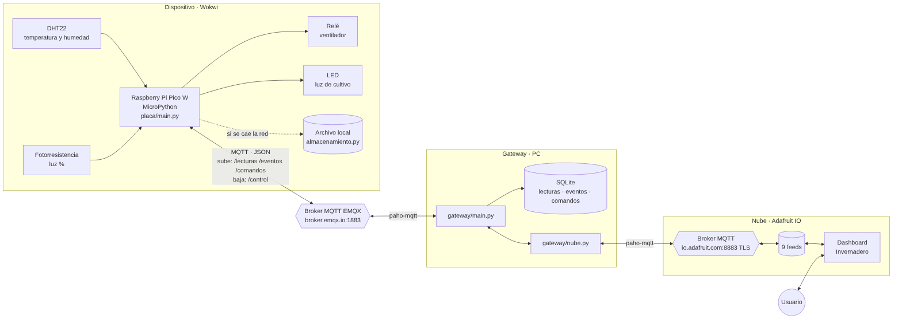
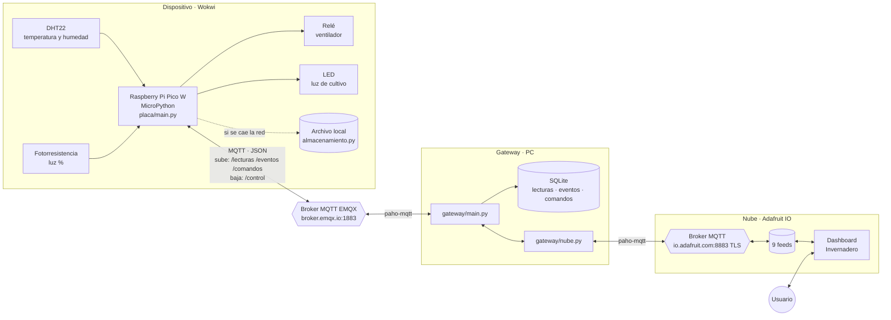

# Arquitectura del sistema

El invernadero tiene tres capas: el **dispositivo** (Pico W simulada en Wokwi), el **gateway** (Python en la PC) y la **nube** (Adafruit IO). Entre el dispositivo y el gateway hay un broker MQTT público (EMQX); entre el gateway y la nube, el broker MQTT propio de Adafruit IO.

Código Mermaid del diagrama (GitHub lo dibuja solo)

## Componentes

| Capa | Componente | Responsable | Qué hace |
|---|---|---|---|
| Dispositivo | `placa/sensores.py` | Francisco | Lee el DHT22 (temperatura, humedad) y la fotorresistencia (luz en %) |
| Dispositivo | `placa/actuadores.py` | Francisco | Enciende y apaga el relé del ventilador y el LED de la luz de cultivo |
| Dispositivo | `placa/reglas.py` | Francisco | Reglas automáticas: más de 30 °C enciende el ventilador; menos de 40 % de luz enciende la luz de cultivo |
| Dispositivo | `placa/red.py`, `conexion_mqtt.py`, `almacenamiento.py`, `main.py` | José | Wi-Fi con timeout, hora NTP, cliente MQTT, muestreo cada 5 s con `Timer` y guardado local si se cae la conexión |
| Transporte | Broker EMQX | — | Broker MQTT público y gratuito; reparte los mensajes entre la placa y el gateway |
| Gateway | `gateway/main.py`, `base_datos.py`, `validaciones.py`, `consultas.py`, `sql/crear_tablas.sql` | Juan | Escucha MQTT, guarda todo en SQLite con su timestamp y reenvía a la placa las órdenes del dashboard |
| Gateway | `gateway/nube.py` | Luis | Sube las lecturas a Adafruit IO (máximo cada 15 s) y traduce los botones del dashboard a órdenes del contrato |
| Nube | Adafruit IO | Luis | Guarda los datos en feeds y los muestra en un dashboard con medidores, gráfica, indicadores y botones |

## Por qué está armado así

**Un gateway en el medio.** La placa solo habla con EMQX; no sabe que existe Adafruit IO. Así la Pico W no necesita guardar la clave de la nube (Wokwi no tiene variables de entorno), y cambiar de plataforma en la nube solo tocaría `nube.py`.

**MQTT en las dos mitades.** Es orientado a eventos: nadie pregunta cada tanto si hay datos nuevos, el broker avisa cuando llegan. El gateway usa dos clientes paho independientes, uno por broker.

**Contrato entre módulos.** `docs/contrato.md` fija tópicos, formato JSON y funciones. Por eso cada integrante pudo programar y probar su parte sin esperar a los demás.

**Feeds de control separados de los de estado.** Los botones escriben en `control-*` y el gateway publica el estado real en `estado-*`. Si fueran el mismo feed, el gateway recibiría su propio estado como si fuera una orden y pasaría la placa a modo manual sin que nadie lo pidiera.

**Límite de 15 s hacia la nube.** La placa publica cada 5 s, pero el plan gratis de Adafruit IO acepta 30 datos por minuto. `nube.py` envía una de cada tres lecturas: hasta 6 datos cada 15 s = 24 por minuto. Los estados solo se envían cuando cambian, así que lo normal son 12 por minuto. SQLite sí guarda todas las lecturas.

**Seguridad.**
- La placa solo ejecuta órdenes que traen el token `INVERNADERO_DS8_2026`; el gateway lo agrega y la placa responde `rechazado` / `token invalido` si no coincide.
- La conexión con Adafruit IO va cifrada con TLS (puerto 8883) y la clave vive en `gateway/secretos.py`, que está en `.gitignore`.
- Los tópicos de EMQX llevan `fran0699` en la ruta para que otro grupo del broker público no los use por accidente.

**Tolerancia a fallas.**
- Si se cae el Wi-Fi de la placa, las lecturas se guardan en la placa y se reenvían al volver, con la hora en que se midieron (evento `reconexion`).
- Si se cae la conexión con Adafruit IO, paho reconecta solo; mientras tanto `enviar_lectura()` devuelve `False` y el gateway sigue guardando en SQLite.

## Tecnologías

| Tecnología | Versión | Uso |
|---|---|---|
| MicroPython | la de Wokwi | Programa de la Pico W |
| Wokwi | — | Simulador del circuito |
| Python | 3.12 | Gateway |
| paho-mqtt | 2.2.0 | Cliente MQTT del gateway, para EMQX y para Adafruit IO |
| EMQX | broker público | Broker MQTT entre placa y gateway |
| SQLite | incluido en Python | Base de datos local |
| Adafruit IO | plan gratis | Dashboard y control remoto |

Para el recorrido de cada mensaje, paso a paso, ver [flujo_datos.md](flujo_datos.md).
