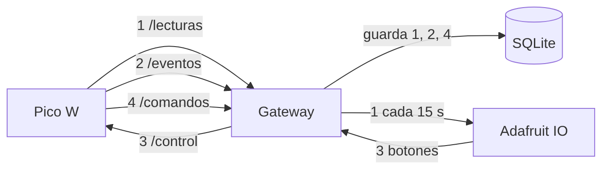
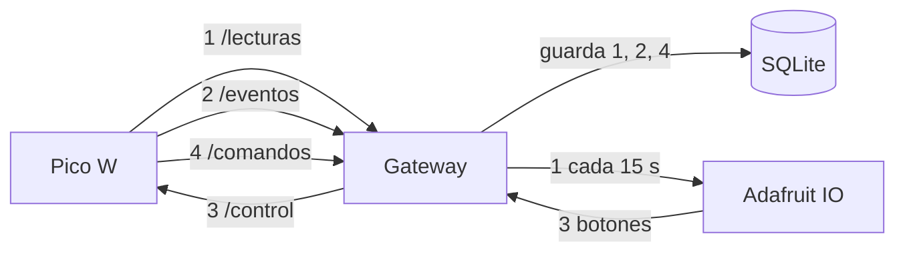
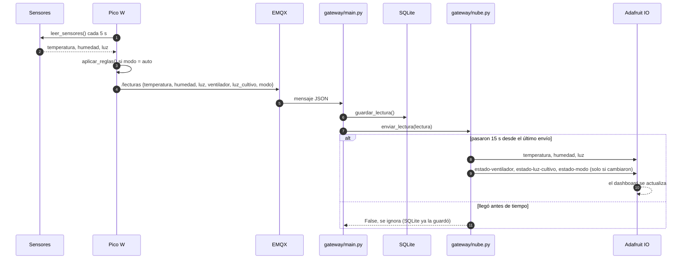
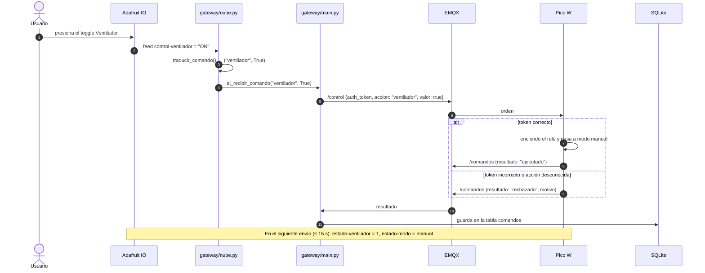
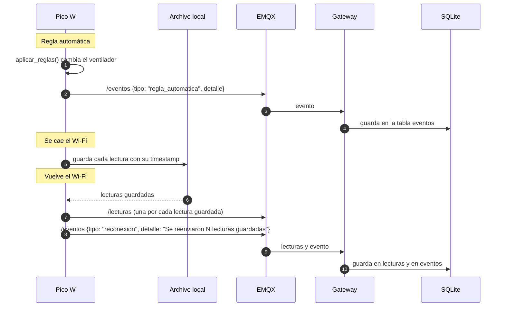

# Flujo de datos

Recorrido de cada tipo de mensaje, desde que se genera hasta que se guarda o se ejecuta. Los tópicos completos empiezan con `utp/fisc/ds8/fran0699/invernadero`; aquí se escribe solo el final (`/lecturas`, `/control`…). El formato exacto de cada mensaje está en [contrato.md](contrato.md), sección 3.

## Resumen

| # | Mensaje | Origen → destino | Tópico o feed | Dónde queda |
|---|---|---|---|---|
| 1 | Lectura de sensores | Placa → gateway → nube | `/lecturas` → feeds `temperatura`, `humedad`, `luz`, `estado-*` | Tabla `lecturas` y dashboard |
| 2 | Evento de una regla o reconexión | Placa → gateway | `/eventos` | Tabla `eventos` |
| 3 | Orden del dashboard | Nube → gateway → placa | feeds `control-*` → `/control` | Se ejecuta en la placa |
| 4 | Resultado de la orden | Placa → gateway | `/comandos` | Tabla `comandos` |

Código Mermaid del resumen

## 1. Lectura: de los sensores al dashboard

1. Cada 5 s el `Timer` de la placa pide una lectura. `reglas.py` decide si cambia algún actuador (en modo `auto`).
2. La placa publica el JSON en `/lecturas`, con la hora NTP en `timestamp`.
3. El gateway lo recibe de EMQX, lo convierte en diccionario y lo guarda con `guardar_lectura()`.
4. El gateway llama a `nube.enviar_lectura(lectura)`. Si pasaron 15 s desde el último envío, `nube.py` publica en los feeds; si no, la ignora.
5. El dashboard se actualiza solo: Adafruit IO avisa al navegador cuando un feed cambia.

Código Mermaid

## 2. Orden: de un botón del dashboard a la placa

1. El usuario presiona el toggle **Ventilador** del dashboard. Adafruit IO escribe `ON` en el feed `control-ventilador`.
2. `nube.py` está suscrito a ese feed: recibe `ON` y lo traduce a `("ventilador", True)`.
3. `nube.py` llama a `al_recibir_comando("ventilador", True)`, la función que le pasó el gateway.
4. El gateway agrega el token y publica en `/control`: `{"auth_token": "INVERNADERO_DS8_2026", "accion": "ventilador", "valor": true}`.
5. La placa revisa el token, enciende el relé y pasa a modo `manual` para que la regla no lo deshaga en la siguiente lectura.
6. La placa publica el resultado en `/comandos` y el gateway lo guarda en la tabla `comandos`.
7. En la siguiente lectura enviada, los feeds `estado-ventilador` = 1 y `estado-modo` = `manual` confirman el cambio en el dashboard.

| Botón | Feed | Valor que manda | Lo que recibe el gateway |
|---|---|---|---|
| Ventilador | `control-ventilador` | `ON` / `OFF` | `("ventilador", True)` / `("ventilador", False)` |
| Luz de cultivo | `control-luz-cultivo` | `ON` / `OFF` | `("luz_cultivo", True)` / `("luz_cultivo", False)` |
| Modo | `control-modo` | `auto` / `manual` | `("modo", "auto")` / `("modo", "manual")` |

Si llega un valor que no está en la tabla (por ejemplo, alguien escribe a mano en el feed), `nube.py` lo muestra en la terminal y no llama al gateway.

Código Mermaid

## 3. Eventos: reglas automáticas y reconexiones

- **Regla automática.** Si `aplicar_reglas()` cambia un actuador, devuelve un texto como `"Temperatura 31.2 C mayor que 30.0 C: ventilador encendido"`. La placa lo publica en `/eventos` con `tipo = "regla_automatica"`.
- **Reconexión.** Si se cae el Wi-Fi, la placa guarda las lecturas en un archivo local. Al volver la conexión las reenvía (cada una con la hora en que se midió) y publica un evento `tipo = "reconexion"`, por ejemplo `"Se reenviaron 4 lecturas guardadas"`.

El gateway guarda los dos tipos en la tabla `eventos`.

Código Mermaid

## Presupuesto de datos en Adafruit IO

El plan gratis acepta **30 datos por minuto** y **10 feeds**.

| Qué | Datos por envío | Envíos por minuto | Datos por minuto |
|---|---|---|---|
| Sensores (temperatura, humedad, luz) | 3 | 4 | 12 |
| Estados, solo cuando cambian | 0 a 3 | 4 | 0 a 12 |
| **Total** | | | **12 a 24** |

Cada clic en un botón del dashboard también cuenta como un dato. Con 24 como máximo queda margen para varios clics por minuto. Si Adafruit IO limita los envíos, `nube.py` lo muestra en la terminal (`Adafruit IO limitó los envíos: …`).
